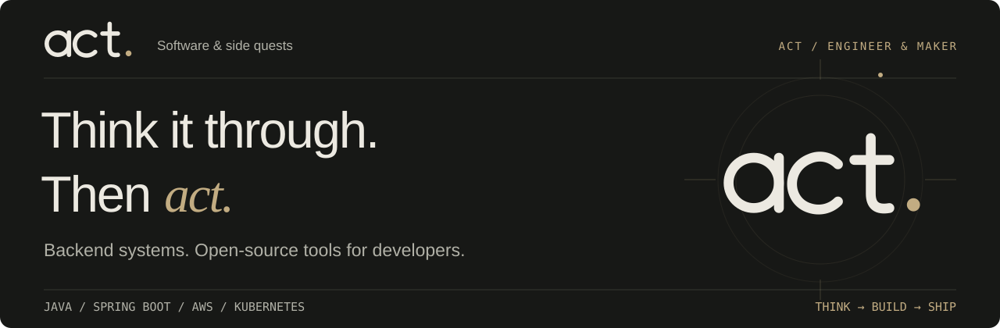
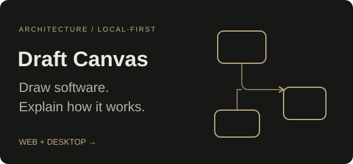
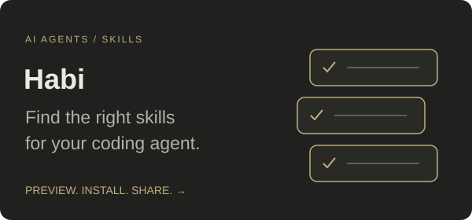
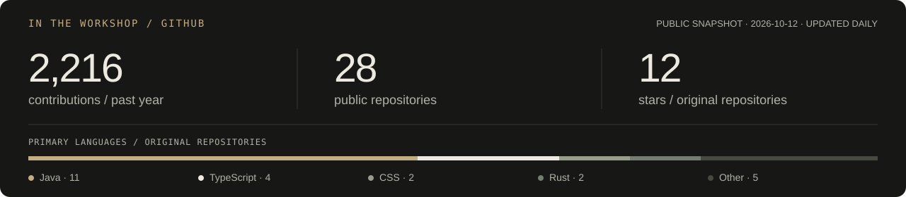

<p align="center">
  
</p>

<p align="center">
  I build backend services for a living and open-source tools for the work around them.
</p>

<p align="center">
  <a href="https://acltabontabon.com"><b>Website</b></a> &nbsp;·&nbsp;
  <a href="https://acltabontabon.com/garage"><b>All projects</b></a> &nbsp;·&nbsp;
  <a href="https://acltabontabon.com/blog">Writing</a> &nbsp;·&nbsp;
  <a href="https://linkedin.com/in/acltabontabon">LinkedIn</a> &nbsp;·&nbsp;
  <a href="mailto:me@acltabontabon.com">Say hello</a>
</p>

<br>

<table>
  <tr>
    <td width="50%" valign="top">
      <a href="https://acltabontabon.com/draft-canvas/"></a>
      <p>Sketch systems, explore the details, and walk through the flow.</p>
      <a href="https://acltabontabon.com/draft-canvas/editor/"><b>Try it →</b></a> &nbsp;·&nbsp; <a href="https://github.com/acltabontabon/draft-canvas">Source</a>
    </td>
    <td width="50%" valign="top">
      <a href="https://acltabontabon.com/habi/"></a>
      <p>See which skills fit your repo and review changes before installing.</p>
      <a href="https://acltabontabon.com/habi/"><b>Explore →</b></a> &nbsp;·&nbsp; <a href="https://github.com/acltabontabon/habi">Source</a>
    </td>
  </tr>
</table>

<p align="center">
  Also building <a href="https://github.com/acltabontabon/vortex"><b>Vortex</b></a> for performance testing and <a href="https://github.com/acltabontabon/Katha"><b>Katha</b></a> for stories from your dev activity.
</p>

<a href="https://github.com/acltabontabon?tab=repositories"></a>

### Install on macOS

Two apps. [One Homebrew tap.](https://github.com/acltabontabon/homebrew-tap)

```sh
brew install --cask acltabontabon/tap/draft-canvas
brew install --cask acltabontabon/tap/habi
```

<sub>[First launch & updates](https://github.com/acltabontabon/homebrew-tap#readme) · Fueled by noodles. Steam time estimates remain unreliable.</sub>
