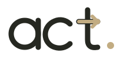
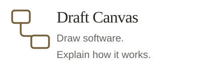
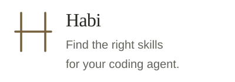
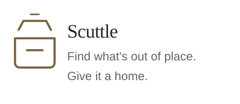
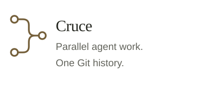
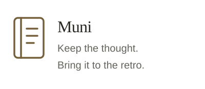
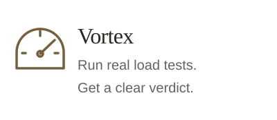

<picture>
  <source media="(prefers-color-scheme: dark)" srcset="assets/act-mark-light.svg">
  
</picture>

### Backend systems. Open-source tools.

Happiest designing software architecture. 
Using AI to turn everyday problems into useful tools.

Java &nbsp; · &nbsp; Spring Boot &nbsp; · &nbsp; AWS &nbsp; · &nbsp; Kubernetes

<a href="https://acltabontabon.com/draft-canvas/editor/"><picture><source media="(prefers-color-scheme: dark)" srcset="assets/garage-draft-dark.svg"></picture></a>

<a href="https://acltabontabon.com/habi/"><picture><source media="(prefers-color-scheme: dark)" srcset="assets/garage-habi-dark.svg"></picture></a>

<a href="https://acltabontabon.com/scuttle/"><picture><source media="(prefers-color-scheme: dark)" srcset="assets/garage-scuttle-dark.svg"></picture></a>

  

<a href="https://github.com/acltabontabon/cruce"><picture><source media="(prefers-color-scheme: dark)" srcset="assets/garage-cruce-dark.svg"></picture></a>

<a href="https://github.com/acltabontabon/muni"><picture><source media="(prefers-color-scheme: dark)" srcset="assets/garage-muni-dark.svg"></picture></a>

<a href="https://github.com/acltabontabon/vortex"><picture><source media="(prefers-color-scheme: dark)" srcset="assets/garage-vortex-dark.svg"></picture></a>

  <a href="https://acltabontabon.com/garage">Garage</a> &nbsp; | &nbsp; <a href="https://ko-fi.com/aclt_attic">Buy me a coffee</a>

