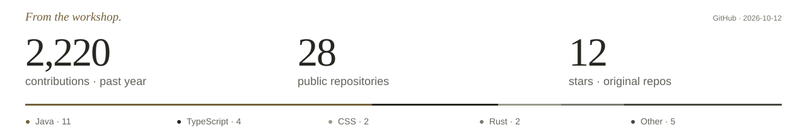

<div align="center">

<picture>
  <source media="(prefers-color-scheme: dark)" srcset="assets/act-mark-light.svg">
  
</picture>

### Backend systems. Open-source tools.

Mostly backend. Happiest with **Java, Spring Boot, AWS, and Kubernetes**.

Lately, I’m using AI to build tools for my own problems and the ones we share.<br>
Less busywork. More time for things that matter.

<sub>Exploring Cloudflare, too.</sub>

[Website](https://acltabontabon.com) · [Writing](https://acltabontabon.com/blog) · [LinkedIn](https://linkedin.com/in/acltabontabon) · [Say hello](mailto:me@acltabontabon.com)

</div>

<br>

<div align="center">

<a href="https://acltabontabon.com/draft-canvas/editor/"><picture><source media="(prefers-color-scheme: dark)" srcset="assets/project-draft-dark.svg"></picture></a>
<a href="https://acltabontabon.com/habi/"><picture><source media="(prefers-color-scheme: dark)" srcset="assets/project-habi-dark.svg"></picture></a>

<sub>[Explore the Garage](https://acltabontabon.com/garage) &nbsp; / &nbsp; [Vortex](https://github.com/acltabontabon/vortex) &nbsp; / &nbsp; [Katha](https://github.com/acltabontabon/Katha)</sub>

</div>

<br>

<picture>
  <source media="(prefers-color-scheme: dark)" srcset="assets/activity-dark.svg">
  
</picture>

<br>

**Take them for a spin.** [My Homebrew tap →](https://github.com/acltabontabon/homebrew-tap)

```sh
brew install --cask acltabontabon/tap/draft-canvas
brew install --cask acltabontabon/tap/habi
```

<sub>[First launch & updates](https://github.com/acltabontabon/homebrew-tap#readme) · Software & side quests. Fueled by noodles.</sub>
